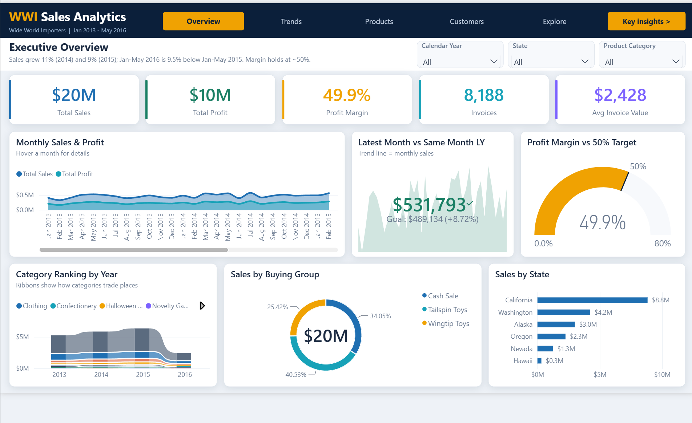
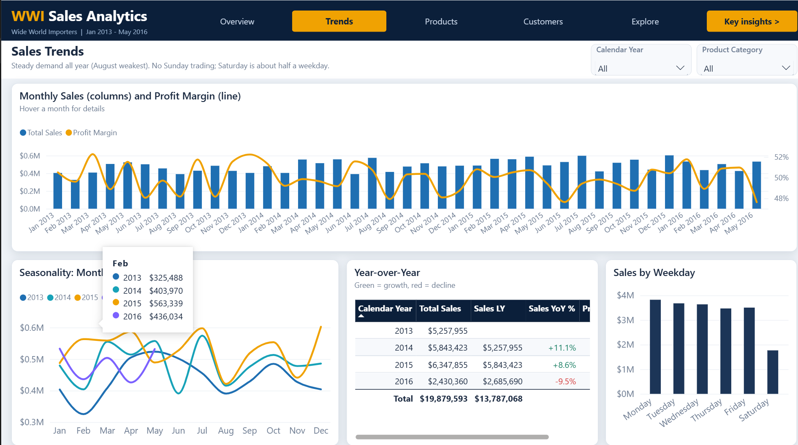
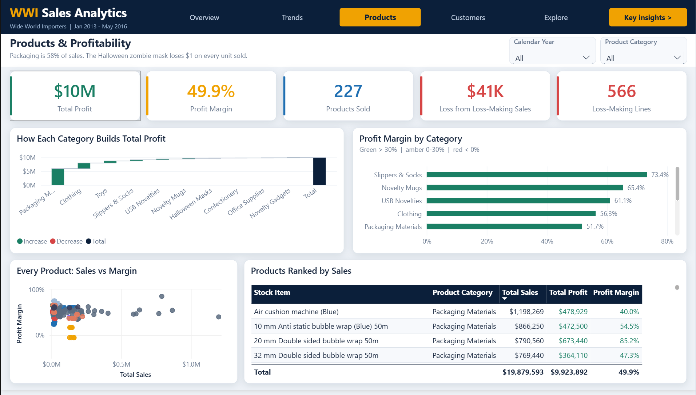
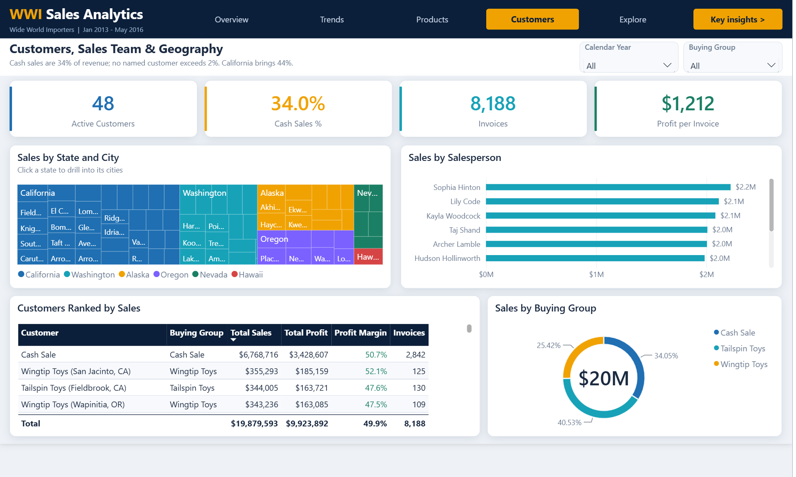
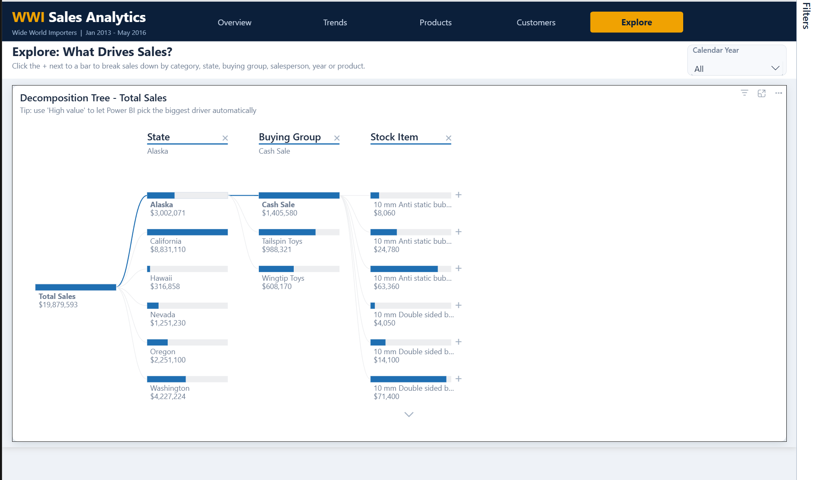

# Power BI Sales Analytics Dashboard

An end-to-end sales analytics project on the **Wide World Importers** dataset: data cleaning in **Power Query**, exploratory analysis in **Excel**, and a 5-page interactive **Power BI** dashboard built on a star-schema model with DAX measures.

**Scope:** 26,397 sales lines, Jan 2013 to May 2016, $19.9M sales, $9.9M profit.

I also rebuilt the same analysis in code (pandas, FastAPI and React). See the [Python version](https://github.com/abdallahelarabyy/python-sales-analytics-dashboard). Both versions give the same totals to the cent.

## Skills demonstrated

- **Power Query (M):** cleaning 6 raw source tables (CSV + Excel): type fixing with locale, trimming/whitespace cleanup, de-duplicating cities with key maps, merges, custom columns (cost, discount %, delivery status, product category), and a parameterized data folder
- **Data modeling:** star schema (1 fact + 5 dimensions, 7 relationships, active/inactive date relationships), marked date table, sort-by columns
- **DAX:** 20 measures, including Sales YoY %, Sales LY, profit margin, average invoice value, cash sales %, loss-making lines, plus conditional-format colour measures
- **Report design:** custom theme, page-tab navigation, bookmarks with slide-in insight panels, a report-page tooltip, KPI cards, gauge vs target, ribbon chart, waterfall, treemap and decomposition tree
- **Excel EDA:** descriptive statistics, time trends, product/customer/geography analysis and outlier review with native Excel charts

## Report pages

| Page | What it answers |
|---|---|
| **Overview** | KPI cards, monthly sales & profit, latest month vs same month last year (KPI), profit margin vs 50% target (gauge), category ranking by year (ribbon), sales by buying group and by state |
| **Trends** | Monthly sales with profit-margin line (combo), seasonality by year, sales by weekday, year-over-year table |
| **Products** | Profit margin by category, how each category builds total profit (waterfall), every product's sales vs margin (scatter), products ranked by sales |
| **Customers** | Sales by salesperson, by buying group, by state and city (treemap), customers ranked by sales |
| **Explore** | Decomposition tree to break total sales down by any dimension |
| *Tooltip - Month detail* | Hover tooltip with month-level KPIs and sales by category |

## Screenshots

### Trends

### Products & Profitability

### Customers, Sales Team & Geography

### Explore: What Drives Sales?

## Key insights

- Sales grew **11% in 2014** and **9% in 2015**, but **Jan-May 2016 is 9.5% below** the same period of 2015.
- Profit margin is stable at **~50%** across years, categories and regions.
- **68 of 227 products drive 80% of sales**: a classic Pareto concentration.
- **California** is the largest state at **$8.8M** in sales.
- **Cash sales** (walk-in customers) are about **34%** of revenue.
- **566 loss-making lines:** 74 deep-discount USB/toy promotions in 2016 and 492 sales of a novelty zombie mask sold below cost (**-$33K**).

## Repository structure

| Path | Contents |
|---|---|
| `Data/` | Raw source files: DimCity, DimCustomer, DimDate, DimStockItem, FactSale (CSV) and DimEmployee (xlsx) |
| `Power BI Pro/` | The Power BI project (`.pbip`): report definition (PBIR) and semantic model (TMDL), with all Power Query steps and DAX measures as readable text |
| `Cleaned Data/WWI_Sales_Cleaned.xlsx` | Cleaned star schema with a cleaning log |
| `Cleaned Data/WWI_Sales_EDA.xlsx` | Exploratory data analysis workbook |
| `docs/screenshots/` | Report page screenshots |

## How to open

1. Install [Power BI Desktop](https://www.microsoft.com/power-platform/products/power-bi/desktop) (Windows).
2. Clone or download this repository.
3. Open `Power BI Pro/WWI Sales Dashboard Pro.pbip`.
4. Go to **Transform data > Edit parameters** and set **DataFolder** to the full path of this repo's `Data` folder (ending with `\`).
5. Click **Refresh**.

The project uses the Power BI Project (`.pbip`) format, so the report, model, Power Query code and DAX can be reviewed directly on GitHub.
